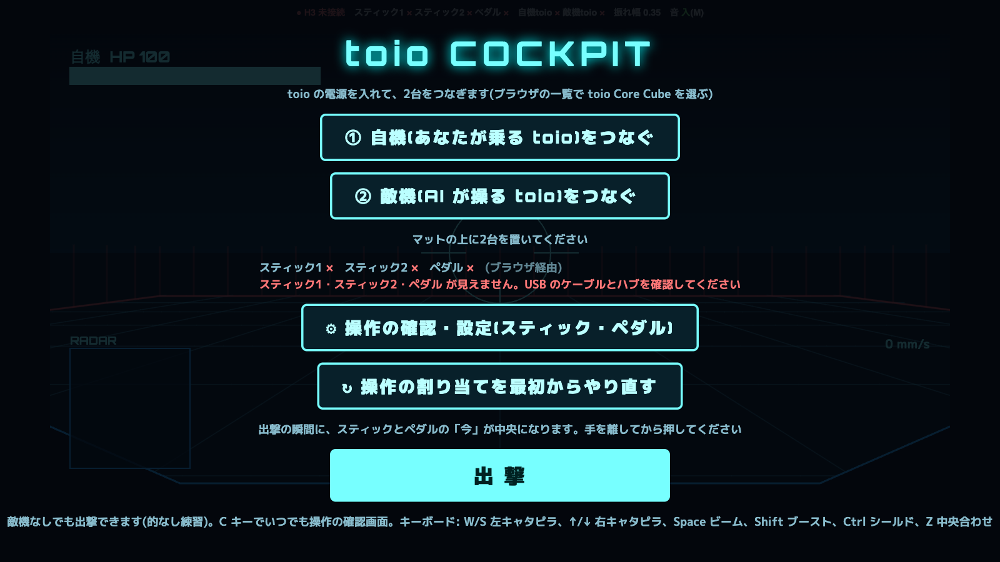

# toio コックピット



マットの上で toio 2台が戦うゲーム。
1台は自分、もう1台は AI が動かす敵。
自分は toio の「中」に乗っている気分で、椅子(DOF Reality H3)が揺れる。
2026年9月のハッカソンで作成。

- 左右のスティック前後 = 左右のキャタピラ
- ペダル = 急旋回・ブースト・シールド
- スティックのボタン = ビーム
- 敵は AI(Gemini)が2.5秒ごとに作戦を決める

## 動かし方

```
pip install pyserial pygame
python3 bridge.py
```

H3 がつながっていなくても、画面だけで遊べる。
スティック等の確認: http://localhost:8891/devices
- ゲーム: http://localhost:8891/mecha (Chrome で開く。toio は Chrome 限定)
- AI を使うときは環境変数 `GEMINI_API_KEY` を設定する

くわしいメモは `TOIO_COCKPIT.md` にある。
